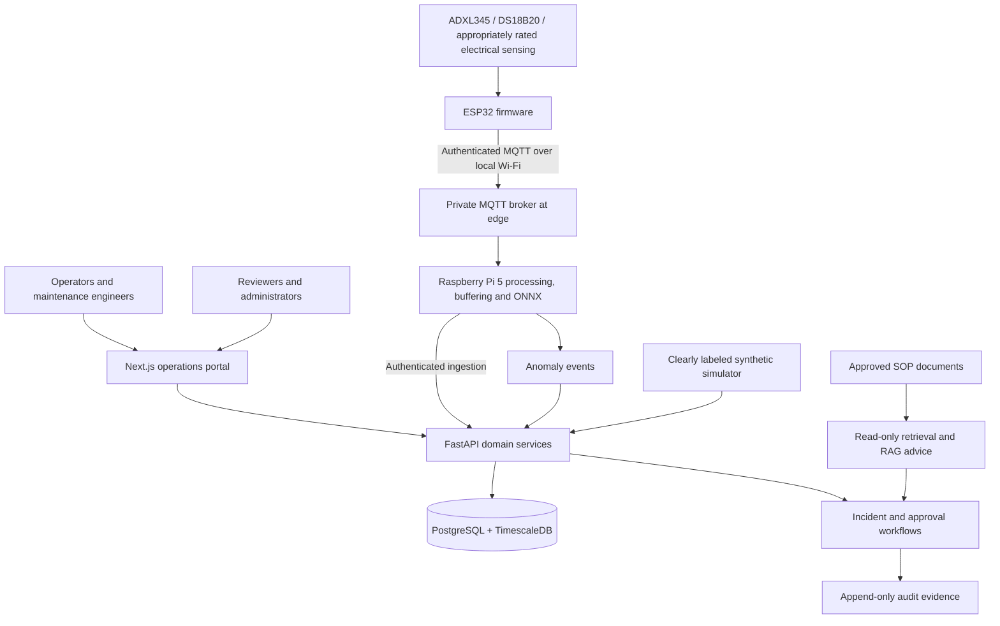

# EDGEOPS — Enterprise Architecture Baseline

> **Current consolidation — 19 November 2026:** Read the [complete production design baseline](../production-design/README.md), [hardware integration map](../production-design/02-HARDWARE-INTEGRATION.md), and [source/evidence reconciliation](../production-design/05-SOURCE-REVIEW.md) first. Historical “not executed” statements below may predate the recorded evidence; the consolidated register preserves each result's exact scope. This is a design proposal, not production or physical approval. EA-32 remains available for the durable-spool implementation previously proposed by EA-31.

**Architecture version:** 0.1 (proposed, unapproved)  
**Date:** 2026-11-17  
**Scope:** Guarded laboratory motor test rig, embedded telemetry, edge AI, enterprise maintenance workflow  
**Implementation status:** Documentation/starter code present; hardware purchase, physical calibration, integrated deployment, security controls and model results not yet independently verified.

## Executive architecture statement

EDGEOPS is a proposed predictive-maintenance platform that integrates a guarded low-voltage DC motor, sensor sampling on ESP32, reliable MQTT transport, Raspberry Pi 5 edge inference, enterprise APIs, PostgreSQL/TimescaleDB, human-reviewed maintenance workflows, and read-only RAG advice. A digital twin is a separately labeled simulator, not evidence that a calibrated physical twin exists.

**Safety principle:** No software, AI agent, model or dashboard may autonomously energize or command safety-critical equipment. A physical motor disconnect and guard must work independently of the application.

## Documentation reading order

1. [Enterprise architecture charter](01-ENTERPRISE-ARCHITECTURE-CHARTER.md) — business scope, stakeholders, capability map, decision rights.
2. [Solution architecture](02-SOLUTION-ARCHITECTURE.md) — C4-style system landscape, trust boundaries and deployment.
3. [System and integration design](03-SYSTEM-INTEGRATION-DESIGN.md) — interfaces, telemetry contracts, API patterns, data ownership.
4. [AI and agent architecture](04-AI-AND-AGENT-ARCHITECTURE.md) — edge inference, model governance, RAG and agent restrictions.
5. [Security, privacy and safety](05-SECURITY-GOVERNANCE-AND-SAFETY.md) — threats, controls, approval and risk register.
6. [Quality, operations and economics](06-QUALITY-OPERATIONS-AND-COST.md) — NFRs, SLO proposal, resilience, DR, FinOps.
7. [Architecture decisions](07-ARCHITECTURE-DECISIONS.md) — proposals, alternatives, consequences.
8. [Design reviews and implementation gates](08-DESIGN-REVIEWS-AND-READINESS.md) — required evidence, tests, acceptance and ownership.

## Additional architecture assurance documents

9. [Requirements traceability](09-REQUIREMENTS-TRACEABILITY-MATRIX.md) — unique FR/NFR IDs, owners, acceptance tests and evidence format.
10. [API and event contract catalog](10-API-EVENT-AND-CONTRACT-CATALOG.md) — proposed MQTT topics, telemetry envelope, service APIs and compatibility.
11. [Data architecture and governance](11-DATA-ARCHITECTURE-AND-GOVERNANCE.md) — logical data model, classification, lineage, retention and access.
12. [Threat model and risk register](12-THREAT-MODEL-AND-RISK-REGISTER.md) — threat boundaries, treatment, stop conditions and review ownership.
13. [AI evaluation and model governance](13-AI-EVALUATION-AND-MODEL-GOVERNANCE-PLAN.md) — held-out evaluation, Pi benchmarks, RAG and agent security tests.
14. [Governance and technical leadership](14-GOVERNANCE-OPERATING-MODEL-RACI.md) — proposed accountabilities, architecture review and change policy.
15. [Portfolio case study and evidence register](15-PORTFOLIO-CASE-STUDY-AND-EVIDENCE.md) — recruiter-oriented narrative, accurate status and proof requirements.

**Document-count note:** README plus 31 numbered architecture documents. All artifacts are design proposals requiring review and measured implementation evidence; created documents are not equivalent to approved architecture.

## Consolidated architecture and career evidence

16. [Master enterprise solution architecture](16-MASTER-ENTERPRISE-SOLUTION-ARCHITECTURE.md) — canonical business-to-edge-to-enterprise architecture, C4 views, AI and agents, controls, operations, and delivery gates.
17. [Architecture gap audit and review register](17-ARCHITECTURE-GAP-AUDIT-AND-REVIEW-REGISTER.md) — explicit open design risks, documentation fixes, unverified claims and reviewer actions.
18. [Six-role competency and interview evidence map](18-ROLE-COMPETENCY-AND-INTERVIEW-EVIDENCE-MAP.md) — maps artifacts to Enterprise AI Architect, AI Solutions Architect, Agentic AI Architect, Senior GenAI Architect, AI Technical Lead, and Security/AI Governance.

**Navigation guidance:** Read EA-16 first for the end-to-end architecture, EA-17 for the unresolved readiness work, and EA-18 for portfolio presentation. EA-01 through EA-15 remain the detailed domain-specific source documents.

**Status note:** This 01–18 reading sequence is foundational; the complete index currently includes EA-01 through EA-31. Authored and committed does not mean stakeholder-approved or deployed.

## Source-level architecture conformance

19. [Architecture-to-code conformance review](19-ARCHITECTURE-TO-CODE-CONFORMANCE-REVIEW.md) — static review of actual ESP32 firmware, serial capture and tests versus the proposed enterprise interfaces.
20. [Serial V1 to telemetry V2 migration and test plan](20-TELEMETRY-CONTRACT-MIGRATION-AND-TEST-PLAN.md) — field-level schema adapter, invalid/missing sensor handling, identities, unit mapping and test cases.

**Important:** The legacy flat serial schema in `phase-01-hardware` is the **actual current source format**. The nested EA-10 schema and the proposed V2 migration are **design candidates**, not implemented, synchronized or tested contracts. Reconcile and approve a single canonical future schema before coding.

## Implementation-readiness architecture review

21. [Implementation-readiness architecture review and decision pack](21-IMPLEMENTATION-READINESS-ARCHITECTURE-REVIEW.md) — consolidates G0–G6 readiness gates, twelve pending decisions, telemetry contract acceptance, security and AI negative test plans, source-to-design evidence, open blockers and signoff sheet.

**Review outcome:** conditional **NO-GO** for motor energization or production claims. The document is a review packet, not evidence of completed design approvals.

## Formal interface control

22. [Interface control document (ICD)](22-INTERFACE-CONTROL-DOCUMENT.md) — proposed canonical telemetry V2, source V1 mapping, security, provenance, retries and 16 acceptance scenarios.

- [Proposed JSON Schema V2](contracts/telemetry-v2.schema.json)
- [Synthetic valid fixture](contracts/examples/telemetry-v2.synthetic-valid.json)
- [Synthetic partial-sensor fixture](contracts/examples/telemetry-v2.synthetic-partial.json)

**Contract status:** candidate and unapproved. Earlier EA-10 and EA-20 remain historical proposals; no code or hardware change has been made. Runtime JSON Schema validation and integration tests are still required.

## Contract verification and security assurance

23. **Contract verification and test evidence** — [EA-23 automated test source](contracts/tests/test_telemetry_v2_contract.py), [local execution record](evidence/EA-23/README.txt), [local test output](evidence/EA-23/test-results.txt). The user executed 18 local contract tests successfully on Python 3.14.8 and committed their evidence at `98f7401`; this demonstrates schema/fixture checks only, not hardware or service integration. A numbered EA-23 prose document and an approved security test environment are not yet present.

24. [Enterprise security and zero-trust verification](24-ENTERPRISE-SECURITY-AND-ZERO-TRUST-VERIFICATION.md) — identity boundaries, device/MQTT TLS, server-side site/asset isolation, RAG and agent restrictions, workflow approval checks, 25 proposed negative security tests and G4a gating.

**Security disposition:** all EA-24 negative scenarios remain **unexecuted**. G4a remains open and physical safety review G4b remains blocking.

## Offline zero-trust authorization policy

25. [Executable zero-trust policy contract and tests](25-EXECUTABLE-ZERO-TRUST-POLICY-AND-TESTS.md) — mock-only deny-by-default role, site/asset, device and workflow authorization semantics with 34 Python tests.
- [Proposed authorization JSON policy](security/policy/edgeops-zero-trust.v1.json)
- [Offline policy evaluator](security/policy/edgeops_policy.py)
- [34 offline unit test cases](security/tests/test_zero_trust_policy.py)

**Test status:** EA-25 is authored/committed, **not executed or validated on the user's computer**. No real OIDC, MQTT TLS, broker topic ACL or security review can be inferred from these offline tests. EA-23 has separately recorded 18 successful local telemetry contract checks.

## Integration security design

26. [Enterprise security integration architecture](26-ENTERPRISE-SECURITY-INTEGRATION-ARCHITECTURE.md) — identity handoffs and trust anchors for serial V1 versus proposed MQTT, gateway-to-API binding, OIDC/RBAC, RAG/agent restrictions, failure behaviors and **20 proposed, unexecuted** sandbox integration checks.

**Verified local evidence:** EA-23 telemetry contract 18/18 and EA-25 offline policy 34/34 passed in the user's local PowerShell runs with evidence pushed. **Unverified:** live MQTT TLS, OIDC, FastAPI, database access and G4a independent security signoff. Physical safety G4b remains blocking.

## EA-27 synthetic sandbox integration

27. [In-memory sandbox security integration test harness](27-SANDBOX-SECURITY-INTEGRATION-TEST-HARNESS.md) — uses EA-22 V2 schema and EA-25 policy together in a synthetic broker/topic, device registry, gateway ingest, asset/SOP, and agent approval flow.
- [Sandbox source](security/sandbox/sandbox.py)
- [24 sandbox integration tests](security/sandbox/tests/test_sandbox_security_integration.py)

**Execution status:** EA-27's 24 new tests are authored and committed but **not yet executed locally or independently reviewed**. Verified earlier evidence remains 18/18 EA-23 schema checks and 34/34 EA-25 offline authorization checks. EA-26 actual broker/API integration scenarios remain unexecuted.

## EA-28 software-only local MQTT and FastAPI security sandbox

28. [Local MQTT mTLS and FastAPI security sandbox](28-LOCAL-MQTT-AND-FASTAPI-SECURITY-SANDBOX.md) — loopback Mosquitto TLS client-certificate ACL configuration, disposable test CA, in-process FastAPI with synthetic JWT/EA-25 policy and schema validation.
- [Docker Compose and local broker configuration](security/live-sandbox/compose.yaml)
- [FastAPI sandbox app](security/live-sandbox/api.py)
- [14 in-process API test cases](security/live-sandbox/tests/test_api_contract.py)
- [3 separately opt-in real-broker tests](security/live-sandbox/tests/test_broker_optin.py)
- [Disposable local test PKI generator](security/live-sandbox/bootstrap_pki.py)

**EA-28 execution status: NOT EXECUTED.** API tests and real broker tests must be run and recorded separately; Docker or cryptographic TLS/OIDC operational evidence is not established by committing code. Previously executed EA-23/EA-25/EA-27 synthetic or offline suites total 76/76.

## EA-29 real localhost MQTT-to-FastAPI gateway integration

29. [MQTT-to-FastAPI gateway integration slice](29-MQTT-TO-FASTAPI-GATEWAY-INTEGRATION.md) — real local mutual-TLS MQTT delivery into a synthetic telemetry gateway, V2 validation, device registry binding, volatile deduplication and in-process authenticated FastAPI TestClient.
- [Gateway implementation](security/live-sandbox/gateway.py)
- [12 real-broker opt-in gateway tests](security/live-sandbox/tests/test_gateway_integration_optin.py)

**EA-29 tests: 12 authored, NOT EXECUTED.** Previous verified baseline remains 93 locally passed tests (EA-23/25/27/28). EA-29 is not a separately deployed HTTP server, durable ingestion or production security evidence.

## EA-30 independent localhost API and durable storage

30. [Independent HTTP API and durable telemetry storage](30-INDEPENDENT-HTTP-API-AND-DURABLE-TELEMETRY.md) — standalone localhost Uvicorn/FastAPI subprocess and SQLite WAL with transactional insert, verified boot-session idempotency, independent-process HTTP test and restart/replay scenario.
- [Independent durable HTTP service](security/live-sandbox/durable_service.py)
- [15 HTTP/SQLite persistence tests](security/live-sandbox/tests/test_durable_http.py)

**EA-30 execution status: 15 tests authored, NOT YET EXECUTED.** Previously locally verified tests remain 105/105. EA-30 does not yet join the real MQTT gateway to the separate HTTP service, and local synthetic JWT/HTTP are not production IAM/TLS.

## EA-31 real MQTT-to-independent HTTP-to-SQLite integration

31. [Real MQTT-to-durable-HTTP gateway integration](31-REAL-MQTT-TO-DURABLE-HTTP-INTEGRATION.md) — real localhost Mosquitto mTLS delivery through an HTTP bridge to separately running Uvicorn/FastAPI and SQLite, with explicit replay after simulated downtime.
- [EA-31 real MQTT-to-HTTP gateway](security/live-sandbox/mqtt_http_bridge.py)
- [12 opt-in real broker/HTTP/SQLite tests](security/live-sandbox/tests/test_mqtt_http_durable_optin.py)

**EA-31: 12 tests authored, NOT YET EXECUTED.** Baseline remains 120 previously verified tests. A broker PUBACK is not a database commit; EA-31 has no automatic offline queue, exactly-once delivery, production OIDC, network HTTPS or hardware safety approval.

## Enterprise architecture landscape

## Evidence labeling policy

- **Proposed:** architecture/design not yet implemented.
- **Implemented locally:** code works in local environment with reproducible log.
- **Tested:** named test, date, commit/environment, pass/fail, artifacts.
- **Deployed (dev/staging/pilot):** host, environment, release and monitoring evidence.
- **Production:** only if live organizational authorization and real operational evidence exist.
- **Synthetic/real/replayed:** every dataset and screenshot must identify provenance.

## Repository links

- [Project README](../README.md)
- [Original Phase 01–08 guides](../README.md#5-eight-phase-engineering-plan)
- [Hardware requirements](../HARDWARE_REQUIREMENTS.md)
- [30-product hardware register](../HARDWARE_30_PRODUCT_REGISTER.md)

## Professional portfolio interpretation

This package demonstrates enterprise AI solution design, embedded/edge architecture, integration, agent safety, risk management and verification discipline. It **does not** establish industrial safety certification, live factory deployment, measured performance or formal TOGAF certification. Review and revise after real measurement.

## EDGEOPS dashboard — Phase 1 synthetic UI

[Open dashboard source and local run guide](../dashboard/README.md) — responsive, browser-local industrial overview, telemetry chart visualizations, simulated asset registry, alerts, illustrative AI insight cards and architecture assurance summary. **No real API integration, live telemetry, model, motor control or production security approval.** The new dashboard source-structure checks are authored but unverified until executed in the user's local checkout. Verified EA-23 to EA-31 baseline remains 132 locally passed tests (separate from dashboard).
