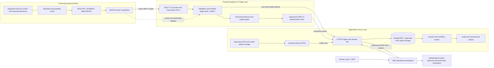

# 01 — System Architecture and Operating Model

**Design baseline:** 1.0 candidate, 19 November 2026. Source references and conflict dispositions are in [05](05-SOURCE-REVIEW.md).

## 1. Product and deployment boundary

EDGEOPS monitors equipment condition and supports accountable maintenance decisions. The initial physical asset is a guarded 12 V laboratory DC motor. The target system uses every category in the existing 30-item hardware register through acquisition, power protection, edge processing, commissioning or spare management. It supports synthetic fleets without presenting them as physical installations.

The platform does not implement an emergency-stop function, energize equipment through a browser, expose PLC commands, or let an AI approve maintenance or deploy a model. The motor driver belongs to a locally supervised bench subsystem. An approved work order is an administrative decision to inspect/maintain equipment; it is not electrical permission or remote execution.

The production target is a defined operational pilot with measured capacity, security, recovery and support ownership. Hobby modules alone do not establish suitability for a factory installation; expansion to actual industrial equipment requires a separately reviewed hardware/sensor/environmental design.

## 2. Design decisions

| ID | Baseline decision | Reason and alternative | Revisit condition |
|---|---|---|---|
| PD-01 | One physical rig first; simulator isolated | Real measurements validate integration; simulated fleets validate software scale | More commissioned physical assets |
| PD-02 | Pi hosts broker, ingestion spool and inference, not the whole enterprise stack | 4 GB Pi resource budget; central services run on a workstation/server | Measured resource contention or higher availability requirement |
| PD-03 | Modular FastAPI application with separate workers | Fewer operational boundaries than premature microservices; domain ownership remains explicit | Independent scaling or ownership requires extraction |
| PD-04 | PostgreSQL owns transactional domain state; TimescaleDB is conditional | Preserve atomic approvals/outbox; benchmark partitioned PostgreSQL if extension compatibility fails | Volume/retention or supported platform changes |
| PD-05 | Current dashboard remains the migration reference; Next.js/TypeScript is the target web client | Preserve working authentication/report behavior while moving to contract-backed screens | Measured cost shows migration adds no value |
| PD-06 | Serial commissioning first, direct device MQTT target | Existing firmware is serial-only; native MQTT requires a deliberate identity/firmware upgrade | Reviewed transport rollout and actual board capabilities |
| PD-07 | MQTT QoS1 plus durable edge store and application receipt states | MQTT PUBACK is not central storage; retries need explicit end-to-end accounting | Workload requires a different transport, not a claim of exactly-once network delivery |
| PD-08 | Rules first, measured anomaly model second | Existing synthetic logistic-regression comparison does not validate a production detector | Independent sessions and held-out evidence justify an ONNX bundle |
| PD-09 | Advisory RAG outside the critical telemetry path | LLM/index outages must not interrupt collection, rules or human workflows | New capability passes a separately reviewed tool policy |
| PD-10 | Three separate approval domains | Offline report review is not model release or maintenance authorization | Governance changes with explicit policy migration |
| PD-11 | Use all hardware through appropriate lifecycle roles | Instruments/spares/conditional interfaces need not be permanently inline | Exact purchased models change the engineered BOM |
| PD-12 | Proposed design, not implicit approval | Source evidence has different scopes and ages | Actual dated reviewer decisions advance specific gates |

These are design recommendations for this baseline; no independent signoff is fabricated.

## 3. Logical architecture

The serial and native-MQTT paths are migration alternatives for an enrolled device, not two sources simultaneously claiming the same live observation stream.

## 4. Runtime component responsibilities

| Component | Owns | Input → output | Failure/degraded behavior |
|---|---|---|---|
| ESP32 acquisition | Sensor schedules, boot/session identity, calibration/config references, counters | I2C/OneWire observations → validated samples/windows | Sensor quality faults; bounded local buffering and explicit loss |
| Mosquitto | TLS peers, exact publisher/subscriber ACL, sessions, limits | Enrolled device messages → scoped consumer | Disconnect/reject; expose backlog, persistence and expiry metrics |
| Edge acquisition adapter | V1 compatibility and trusted serial-port binding | Legacy serial → normalized candidate V2 | Quarantine ambiguous restarts or unknown attachments |
| Edge inbox/spool | Durable acceptance, bounded storage and replay state | Validated source event → local receipt, retry item | No success receipt before commit; alarm on disk-full/corruption |
| Feature engine | Units, timing, window membership and quality | Measured samples → feature windows | Invalid window/abstention, not fabricated features |
| Inference service | Approved bundle hash, thresholds and scores | Valid feature window → scored result/quality result | Model unavailable or rule-only mode, explicitly labeled |
| Ingestion API | Trusted device/site binding, validation, conflict-aware dedupe | Authenticated edge record → committed event reference | 4xx rejection/quarantine or retryable 5xx; no false acknowledgement |
| Domain API | Authorized asset, incident, approval and work-order state | Scoped human/service request → versioned response | Reject unauthorized/stale transitions and record outcomes |
| Incident/outbox worker | Correlation, escalation, domain events and retries | Committed facts → incident updates and notifications | Idempotent replay and visible worker backlog |
| RAG worker | Authorized retrieval, source revisions and proposal provenance | Incident evidence + eligible SOP → draft or abstention | Copilot unavailable; core workflows remain usable |
| Web/BFF | User session, presentation, filters, evidence views | Authorized queries/SSE hints → operator views | Explicit loading, denied, stale, unavailable and empty states |
| Operations plane | Metrics, traces, backups, release and identity lifecycle | Service telemetry → alerts/runbooks/recovery records | Assigned operator response and tested rollback |

## 5. Physical placement and resource ownership

**Protected bench:** motor, rated driver/suppression/protection, fixed sensors, ESP32, low-voltage connectors and enclosure. Breadboard/jumpers are bring-up equipment rather than the final motor-current path.

**Raspberry Pi 5 (4 GB):** 64-bit OS, dedicated compatible supply, case/cooler, microSD; private broker, edge agent, durable SQLite WAL spool and ONNX Runtime CPU. Run the edge processes under systemd or an equivalently measured supervisor with restricted users, log rotation and restart policies. Reserve disk space for OS and recovery. Benchmark thermal behavior with the actual case/cooler and concurrent ingestion/inference.

**Workstation for development, dedicated Linux host/VM for staging/pilot:** reverse proxy, web/BFF, FastAPI, domain/outbox workers, PostgreSQL, controlled SOP/model storage, identity provider and observability. Do not assume these fit reliably on the Pi alongside acquisition. An existing workstation can demonstrate a deployment but is not an approved always-on production service by default.

**Supporting infrastructure outside the 30-category register:** isolated router/LAN, administration workstation, suitable ESP32 USB supply, reviewed electronics enclosure, backup destination, deployment host and network cabling. UPS or higher-endurance edge storage is a separately assessed resilience upgrade. Account for these dependencies rather than claiming the shopping register is a complete operational installation.

## 6. Network and identity zones

| Flow | Target protocol | Principal and restriction |
|---|---|---|
| Enrolled ESP32 → Pi broker | MQTT over TLS, private reviewed listener | Unique device identity; own telemetry/status; own application-ack subscription only if explicitly provisioned |
| Serial ESP32 → Pi commissioning adapter | Local USB/UART | Gateway-attested attachment; no claim of device mTLS |
| Pi MQTT consumer | TLS and exact subscriptions | Edge service can consume only enrolled device topics |
| Pi → central API | HTTPS plus scoped service identity | Gateway ingest rights; no human approval or arbitrary tenant rights |
| Browser → web/BFF | HTTPS, OIDC-backed server session | Authorization Code/PKCE integration; HttpOnly/Secure/SameSite cookies and CSRF protection |
| API/workers → database | Private DB network; verified TLS across hosts | Separate app, migration, backup and read roles |
| Worker → SOP/model objects | Authenticated controlled object/file storage | Scoped read/write rights; document/model permissions distinct |
| Admin/monitoring → services | Restricted management network | Named administrators; no public DB/broker/debug endpoint |

The human identity provider is configurable; a dedicated Keycloak realm is one candidate, not an assumption that an existing unrelated project realm may be reused. Do not deploy the lab's shared HS256 test signer as production IAM. Use an explicit trusted issuer/JWKS policy, audience, expiry and algorithm allowlist; apply revocation and current entitlements again for sensitive decisions.

TLS authenticates the peer, not the physical sensor accuracy. A broker subscriber does not obtain a publisher's certificate identity from the JSON payload. Attribution relies on a protected principal-to-exact-topic registry and broker enforcement, or a separately designed signed event envelope.

## 7. Durable delivery and degraded operation

The states are **device-created → broker-accepted → edge-committed → central-committed → workflow-processed**. Store and display these separately. Each state has event identity, timestamp, retry count and reason. Broker PUBACK alone never means central storage succeeded.

1. Validate identity/topic, size, schema and semantics at the edge.
2. Commit an edge inbox record and upstream outbox item atomically, under a bounded disk policy.
3. Acknowledge consumer delivery only after local durability using a client/manual-ack mode that has been verified for the deployed library. Broker persistence/session configuration and crash behavior also require tests.
4. Where device-level delivery accounting is required, return a restricted **application receipt** after edge commit. This is an ingestion receipt, not a command topic. Device records may be retired only under the explicitly implemented receipt policy.
5. Forward upstream with a stable event identity and exponential backoff/jitter. Persist attempts and scheduling, not an in-memory-only retry queue.
6. Mark upstream complete only after verified central commit. A lost HTTP response permits retry; the central key/hash rule resolves ambiguity.
7. Quarantine permanent schema/authorization/conflicting-payload failures with a reason; retry transient network/server failures. Refresh expired credentials through the reviewed identity path instead of retrying bad credentials indefinitely.
8. On storage exhaustion, stop acknowledging new durable acceptance; surface backpressure and count every discarded device/window record. Never silently erase pending telemetry to keep an uptime light green.

A single Pi or microSD remains a failure domain. Even SQLite synchronous commit does not make consumer media immune to power loss; qualify storage, supervise power behavior, reconcile broker/spool state after restart, and document measured losses. Raw waveform retention has its own quota so it cannot exhaust the essential event spool.

| Failure | Required user-visible state and response |
|---|---|
| Backend/network outage, sensor→Pi still working | Local collection/rules/inference continue; central view stale; bounded backlog/replay |
| Sensor→Pi transport lost | No new local observations; never say inference continues on fresh data |
| Sensor unplugged/clipped/stale | Sensor fault/degraded or no score; unaffected channels remain visible |
| Pi or broker unavailable | Device disconnected/stale after configured freshness checks |
| Wrong or expired certificate | Reject without plaintext fallback; alert credential owner |
| Corrupt model / incompatible feature schema | Reject bundle; explicitly approved compatible rollback or rules-only mode |
| Identity provider unavailable | New sensitive actions denied; session behavior follows reviewed expiry policy |
| RAG/index outage | Advice unavailable/abstain; investigation and human-maintained workflow continue |
| Duplicate notification/workflow event | One logical effect under durable key; retain attempt history |

## 8. AI and model operations

Separate training on a workstation from edge inference. Split independent recording sessions/assets before overlapping window generation and apply a time gap where feature history could leak. Fit scalers on training only, choose thresholds on validation, freeze final test sessions, and compare identical holdouts. Operating-state variations are not confirmed bearing failures. Unknown speed/load remains unknown without an actual sensor or recorded procedure.

Use quality/threshold rules as the first online baseline. An ONNX detector becomes eligible only with dataset lineage, meaningful labels/healthy-session false-alarm evidence, parity checks, measured Pi runtime and explicit approval. Record model score, threshold, feature schema and interpretation; do not display failure probability or RUL without separately validated models/labels.

One immutable bundle contains feature extractor/config, sensor/unit contract, scaler, ONNX/rules, thresholds, dependencies, dataset/split hashes, source revision, model card and evaluation report. Model lifecycle: candidate → evaluated → staged → release-approved → active → retired. Keep deployment request, release approval, activation health and compatible rollback distinct. The existing report's “approved” status cannot activate a bundle.

RAG uses licensed/authorized SOP revisions, ACL filtering before retrieval and at citation return, strict output schemas, bounded tools, budgets and timeouts. Missing/wrong/contradictory evidence produces abstention. The agent may draft; it cannot approve, run shell/SQL, change grants, publish control commands or deploy models. Human edits create new proposal revisions.

## 9. Sizing and operational assumptions

The baseline engineering scenario is **one real rig**, a separate 10-device synthetic fleet, and up to 20 simulated viewers for initial load characterization. These are test inputs, not proven capacity. Begin with a 1 Hz feature publication cadence; establish high-rate sampling independently.

Illustrative storage arithmetic: one 1 KB feature record/s is 86,400 records/day or approximately 86.4 MB/day before indices, WAL, receipts, replicas and backups. At 100 devices this becomes 8.64 GB/day before overhead. A candidate 400-sample/s, three-axis, 16-bit raw signal is 2.4 KB/s or 207.36 MB/day per device before metadata/encoding. JSON and overlapping-window copies increase this substantially. Prefer bounded raw captures and object storage rather than permanent sample-by-sample relational writes.

Size the spool using `devices × records/s × measured serialized bytes × outage seconds × measured overhead/safety margin`. A proposed 24-hour outage scenario must fit actual media quotas and survive tests before becoming a commitment. A 64 GB card label is not a proven retention guarantee.

Record proposed and observed sample rate/jitter, sensor completeness, sensor-to-edge and edge-to-central delay, API/query percentiles, CPU/RAM/thermal load, viewer count, disk growth, false alerts/hour, restore time and backup loss window. Business owners accept targets after baseline measurement; no 99.9% availability or arbitrary latency result is declared here.

## 10. Operations, release and recovery

Expose separate liveness/readiness checks and protected metrics. Readiness reflects dependencies; it does not certify equipment health. Trace a source event through edge receipt, central ingestion, inference, incident, proposal, approval and audit using stable causation IDs.

Monitor device gaps/clock quality, per-sensor validity, broker denials/backlog, spool age/capacity/drop counts, inference version/errors/latency, API authorization/errors, DB/WAL/retention, outbox backlog, SSE refetch failures, SOP revision/index health, approval conflicts, certificate expiry and backup/restore age. Each alert needs an owner, trigger, escalation, mitigation and recovery verification.

Use separate development, staging and approved measured-pilot configurations/identities/data. Pin compatible runtime/image/dependency versions in a release manifest after compatibility tests; generate SBOMs, scan secrets/dependencies, sign artifacts where supported, and require staging smoke/recovery checks before manual promotion. Do not convert a Compose example into an asserted production deployment.

Back up database, object manifests/artifacts, configuration and recovery procedures to an encrypted off-host destination. Define and approve RPO/RTO, verify clean-environment restoration and record actual loss/recovery time. Reconcile references and pending outbox work after restore. Keep existing SQLite accounts/reports backed up and readable through migration; never copy ephemeral sessions or test credentials into the production identity system.
